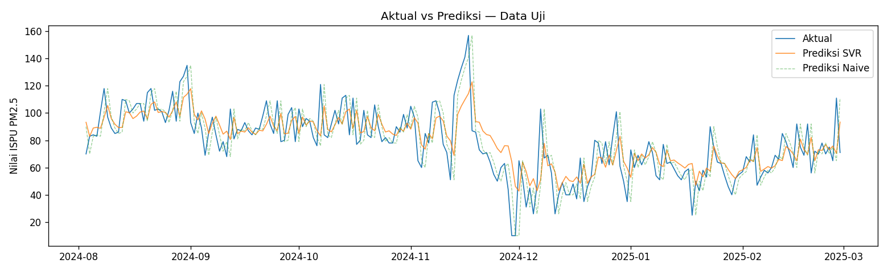

# Peramalan Nilai PM2.5 Harian DKI Jakarta Menggunakan Support Vector Regression dengan Time Series Cross-Validation


## 📌 Deskripsi Proyek

Proyek ini membangun model **Support Vector Regression (SVR)** berkernel **RBF** untuk meramalkan **nilai PM2.5 harian DKI Jakarta satu hari ke depan** (*one-step-ahead forecasting*), menggunakan data Indeks Standar Pencemar Udara (ISPU) periode 2021–2025. Model dievaluasi dengan validasi yang menjaga urutan waktu (*time series cross-validation*), tanpa kebocoran data, dan dibandingkan dengan baseline *naive (persistence)*.

## 📈 Temuan Kunci (Key Findings)

1. **SVR mengalahkan baseline, tetapi keunggulannya moderat.** RMSE turun dari 18,65 (naive) menjadi 16,59 (turun 11,0%), dan R² naik dari 0,41 menjadi 0,53. Model menjelaskan sekitar separuh variasi harian PM2.5; sisanya (±47%) belum terjelaskan oleh riwayat PM2.5 saja.
2. **Lebih sedikit fitur justru lebih baik.** Dari 12 kandidat fitur, forward selection dengan `TimeSeriesSplit` hanya memilih 2: nilai kemarin (`pm25_lag1`) dan rata-rata 14 hari (`pm25_roll14`). Menambah fitur ketiga (lag 10) menaikkan RMSE validasi dari 20,65 menjadi 21,28, dan fitur musiman bulan tidak terpilih. Lag yang lolos uji PACF belum tentu berguna bagi model ([grafik](docs/forward_selection.png)).
3. **CO dan O₃ membantu sedikit, PM10 tidak.** Pada baris data yang sama untuk semua skenario, menambah CO dan O₃ menurunkan RMSE dari 17,07 menjadi 16,37 (4,1%). Menambah PM10 justru memperburuk hasil menjadi 18,26, dan gabungan semua polutan paling buruk (20,44). Penyebab PM10 merugikan belum diuji.
4. **Model sulit menangkap perubahan mendadak.** Empat dari lima kesalahan terbesar adalah lonjakan yang diremehkan, misalnya 17 November 2024: aktual 157, prediksi SVR 114 (selisih ±43 poin). Kesalahan terbesar justru penurunan tajam: pada 29 November 2024 aktual 10 tetapi prediksi 64 (selisih ±54 poin).
5. **Pola musiman dan pergeseran level memengaruhi evaluasi.** Rata-rata PM2.5 tertinggi pada Juli (111,3) dan terendah pada Januari (69,2). Periode uji (Agustus 2024 – Februari 2025) rata-ratanya 78,1, sekitar 15% lebih rendah dari data latih (91,6), sehingga hasil uji belum tentu mewakili periode lain.

## Notebook

| # | Notebook | Isi | Colab |
|---|---|---|---|
| 1 | [`01_data_wrangling`](01_data_wrangling.ipynb) | Membaca data, memilih periode, memeriksa dan menangani missing value | [](https://colab.research.google.com/github/YudhaAlfarizi/jakarta-pm25-svr-forecasting/blob/main/01_data_wrangling.ipynb) |
| 2 | [`02_eda`](02_eda.ipynb) | Statistik deskriptif, tren, pola bulanan, distribusi, ACF/PACF | [](https://colab.research.google.com/github/YudhaAlfarizi/jakarta-pm25-svr-forecasting/blob/main/02_eda.ipynb) |
| 3 | [`03_feature_engineering`](03_feature_engineering.ipynb) | Fitur lag, rolling mean, fitur musiman, split kronologis latih/uji | [](https://colab.research.google.com/github/YudhaAlfarizi/jakarta-pm25-svr-forecasting/blob/main/03_feature_engineering.ipynb) |
| 4 | [`04_svr_modeling`](04_svr_modeling.ipynb) | Baseline naive, forward selection, tuning SVR, evaluasi, analisis residual, eksperimen polutan tambahan | [](https://colab.research.google.com/github/YudhaAlfarizi/jakarta-pm25-svr-forecasting/blob/main/04_svr_modeling.ipynb) |

## Dokumentasi

- [`docs/dataset.md`](docs/dataset.md) — sumber data, kolom, karakteristik dan masalah kualitas data, cara mengunduh
- [`docs/metodologi.md`](docs/metodologi.md) — alur penelitian, alasan tiap langkah, landasan matematis SVR, referensi

## Ringkasan Data

- **Sumber:** Indeks Standar Pencemar Udara (ISPU) DKI Jakarta, diterbitkan Dinas Lingkungan Hidup Provinsi DKI Jakarta melalui portal Satu Data Indonesia
- **File:** `ispu_dki_all.csv`, gabungan data 5 stasiun pemantau kualitas udara (SPKU)
- **Periode dipakai:** 1 Januari 2021 – 28 Februari 2025 (nilai PM2.5 baru tersedia sejak 2021)
- **Target:** `pm25`
- **Satuan:** ISPU adalah **angka indeks tanpa satuan** (dikonfirmasi Dinas Lingkungan Hidup DKI Jakarta), bukan konsentrasi µg/m³

Detail lengkap dan angka yang dihasilkan notebook 01: [`docs/dataset.md`](docs/dataset.md).

## Hasil Proyek

### Hasil utama (seluruh data uji, 210 hari)

| Model | RMSE | MAE | sMAPE (%) | R² |
|---|---|---|---|---|
| Naive (persistence) | 18.65 | 14.00 | 19.73 | 0.41 |
| **SVR (fitur terpilih, tuned)** | 16.59 | 12.87 | 17.77 | 0.53 |

### Eksperimen variabel tambahan

Semua skenario dilatih dan diuji pada **baris yang sama** (1.153 hari latih, 204 hari uji; hanya baris yang memiliki seluruh fitur polutan), dengan hyperparameter tetap (tidak di-tuning), sehingga perbandingannya adil.

| Model | RMSE | MAE | sMAPE (%) | R² |
|---|---|---|---|---|
| Naive (persistence) | 18.20 | 13.87 | 19.83 | 0.42 |
| SVR (PM2.5 saja) | 17.07 | 13.33 | 18.69 | 0.49 |
| SVR + CO, O₃ | 16.37 | 12.87 | 18.21 | 0.53 |
| SVR + PM10 | 18.26 | 13.88 | 19.22 | 0.41 |
| SVR + semua polutan | 20.44 | 15.94 | 21.84 | 0.27 |

> Tabel eksperimen tidak boleh dibandingkan langsung dengan tabel utama (baris data berbeda dan hyperparameter tidak di-tuning).



Tabel prediksi harian lengkap (aktual vs SVR vs naive, 210 hari data uji): [`docs/hasil_prediksi.csv`](docs/hasil_prediksi.csv).


## Struktur Repositori

```
jakarta-pm25-svr-forecasting/
├── data/            
├── docs/          
├── 01_data_wrangling.ipynb
├── 02_eda.ipynb
├── 03_feature_engineering.ipynb
├── 04_svr_modeling.ipynb
├── README.md
├── requirements.txt
└── LICENSE
```

## 🚀 Cara Menjalankan Model

**Google Colab (disarankan):** klik tombol Colab di tabel notebook, lalu *Runtime → Run all*, dimulai dari notebook 1.

**Lokal:**

```bash
git clone https://github.com/YudhaAlfarizi/jakarta-pm25-svr-forecasting.git
cd jakarta-pm25-svr-forecasting
pip install -r requirements.txt
jupyter notebook
```

## Penulis

**Yudha Alfarizi** — Lulusan Matematika S1· [LinkedIn](https://www.linkedin.com/in/yudha-alfarizi-07588a286/) · [📧 Email](https://mail.google.com/mail/?view=cm&fs=1&to=yudhaaakerja29072026@gmail.com)
## Lisensi

Kode dirilis di bawah lisensi MIT. Dataset mengikuti lisensi sumber aslinya (Kaggle).
